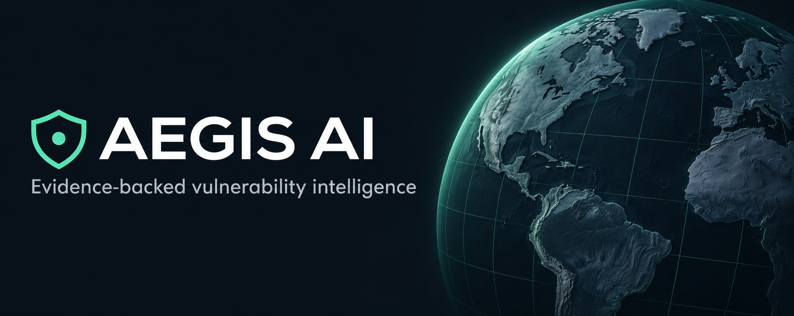

# AEGIS AI



**Evidence-backed vulnerability intelligence**

Product overview and technical datasheet · AEGIS V2 · November 2026

[Versión en español](README.md) · [Download English PDF](AEGIS-AI-EN.pdf)

**[Open AEGIS](https://aegis.oscarbahamonde.com/)** · **[Explore the exposure globe](https://aegis.oscarbahamonde.com/demo/exposure/)**

## Product overview

AEGIS brings software vulnerability information into one workspace to help teams
answer three questions. **What deserves attention first? What do we know? What
can we do about it?** Every investigation links to the sources that support its
conclusions.

### The problem

Vendor advisories, vulnerability records, and exploitation signals are often
reviewed separately. A flaw may have a high severity score, a low estimated
likelihood of exploitation, or documented evidence that it is already being
exploited. Each signal answers a different question. When that context gets lost,
it becomes harder to explain which issue should be addressed first and why.

### How AEGIS helps

| What teams need | What AEGIS provides |
| --- | --- |
| Decide what to review first | A catalog that distinguishes severity, estimated likelihood, and known exploitation. |
| Understand what might be affected | A vulnerability profile with products, versions, and related weaknesses when the source documents them. |
| Explain a recommendation | An investigation that links to its evidence and identifies gaps. |
| Coordinate the next step | An editable handoff draft for the team to review and share through its usual channels. |

AEGIS is designed for security, infrastructure, and risk teams. Analysts can
review the sources and affected versions. Operations leads can read the
recommendation, understand why it matters, and assign the next step.

### A typical workflow

1. Search for a vulnerability by its identifier and open its profile.
2. Check which products may be affected, whether exploitation has been documented,
   and how the estimated likelihood has changed.
3. Start a mitigation investigation and review the evidence behind each recommendation.
4. Review the handoff draft and decide how to escalate or share the case.

The public globe lets you explore historical exposure observations by country.
The demo shows each observation’s source, date, and unit. **No data** means the
sample contains no evidence for the selection.
[Interactive demo](https://aegis.oscarbahamonde.com/demo/exposure/) ·
[Shadowserver publication](https://www.shadowserver.org/news/shadowserver-2025-highlights-of-the-year-in-review/)

---

## Technical datasheet

### Architecture and stack

| Component | Technology | Role |
| --- | --- | --- |
| Interface | Nuxt 4, Vue 3, TypeScript, Tailwind, and Vercel | Workspace, catalog, visualizations, and Nitro session routes. |
| Ingestion and normalization | Python 3.12, Polars, and PyArrow | Captures source data, validates schemas, and normalizes records to Parquet. |
| Local analytics | DuckDB | Reproduces queries against pinned captures and verifies results. |
| Data platform | Amazon S3, Apache Iceberg, AWS Glue, and Athena | Retains artifacts, versions tables, and serves analytical reads. |
| API | FastAPI, Pydantic, regional API Gateway, and AWS Lambda | Validates queries, enforces authorization, and streams responses. |
| Investigations | LangGraph, MCP, Amazon Bedrock, and AgentCore | Orchestrates evidence retrieval and validates reports before delivery. |
| Identity | OB Auth, Amazon Cognito, and OAuth with PKCE S256 | Manages sessions, email verification, and access control. |
| Infrastructure and testing | AWS CDK, pytest, Ruff, mypy, and Playwright | Defines resources and verifies contracts, types, and user workflows. |

[Hosting runbook](docs/hosting.md) · [Data platform](docs/v2-cloud-lakehouse.md) ·
[Query contracts](docs/serving-contracts.md)

### Data and investigation approach

**Reproducible captures.** AEGIS preserves source dates, artifacts, and their
checksums. The catalog unifies CVE identifiers while retaining where each
assessment came from. Queries and investigations use pinned data versions so a
source update leaves the evidence for an ongoing investigation intact.

**Evidence-backed analysis.** LangGraph plans the request, retrieves evidence
through typed queries, analyzes the results, and validates the output. When
Bedrock is used, the model selects claims from facts already retrieved. AEGIS
checks evidence identifiers before issuing the report. Server-sent events (SSE)
stream progress and let an investigation owner resume the stream. The owner
can also cancel the investigation. The mitigation draft remains subject to
human review.
[Investigation design](docs/g4-investigations.md)

**Scoped access.** The workspace requires a valid OB Auth session. Google
sign-in requires a verified email. Email and password sign-in also requires an
authenticator code. The API enforces workspace membership and resource ownership
on the server. The geographic demo is public. The workspace catalog and
investigations require sign-in.
[Identity and authorization](docs/identity-management.md)

### Sources and verified coverage

| Signal | What it provides | Documented scope |
| --- | --- | --- |
| CVE Program and NVD | Identifiers, descriptions, CVSS severity, and product applicability | 431,133 distinct CVEs in the pinned catalog. |
| FIRST EPSS | Estimated likelihood of exploitation over the next 30 days | 465,857,152 scores across 2,042 available dates from 2021-04-14 to 2026-11-24. Nine dates are absent from the source. |
| CISA KEV | Evidence of known exploitation | AEGIS retains the source for each CVE’s inclusion. |
| Shadowserver | Observed geographic exposure in a historical sample | Seven country-level observations across five countries and three dates in 2025. Partial coverage. |

CVSS describes severity. EPSS estimates likelihood. KEV records known
exploitation. The globe shows geographic observations according to the
published scope. The Shadowserver sample preserves original units and leaves
unreported country totals unknown. It supports investigation of individual
historical cases with partial coverage. The demo uses public observations.
[Source register](docs/source-register.md) · [Time series](docs/timeseries.md) ·
[Geographic evidence contract](docs/geography-contract.md#demo-histórica-de-shadowserver)

### Recorded verification

- **Production, November 26, 2026.** Chromium verified the OB Auth callback,
  dashboard access, authenticated catalog reads, and denial of the same request
  after logout. Two public tests covered the globe and the mobile list without
  WebGL.
- **Integration regression.** The release record documents 92 backend tests,
  four frontend contract tests, linting, type checking, and the complete
  Vercel build.
- **Response quality.** A historical Nova Micro evaluation found evidence
  supporting seven of seven claims across two mitigation investigations.
  The result applies to those runs and their pinned evidence.

[Release and acceptance record](STATUS.md) · [Evaluation and measurements](docs/evaluation.md)

## Local development

Use Python 3.12 with `uv`, Node 22.22.3, and pnpm 10.32.1. The preflight checks
the macOS ARM64 toolchain, including AWS CLI v2. This workflow uses the smaller
local CISA KEV capture with NVD enrichment.

```sh
make preflight
make bootstrap
make ingest-local
make validate-data
make smoke-local
make dev
```

FastAPI listens at `http://127.0.0.1:8000`. The API documentation is at `/docs`
and the MCP Streamable HTTP endpoint is at `/mcp/`. The server prints the path
to a development token that expires after 15 minutes. Start Nuxt in a second
terminal.

```sh
make frontend-install
NUXT_PUBLIC_LOCAL_TOKEN_AUTH=true sh scripts/frontend.sh dev
```

Open `http://localhost:3000` and enter the development token. To reuse an
existing capture, set `SNAPSHOT=<run-uuid>` on supported Make targets.
Captures and local evidence are stored in `data/` by default. The hosted
application reads the production catalog and historical data from AWS.
[Example configuration](.env.example) · [V2 ingestion](docs/v2-ingestion.md)

## Resources and attribution

- [Demo guide](docs/final-demo.md) and [investigation runbook](docs/g4-investigations.md).
- [Data dictionary](docs/data-dictionary.md) and [cost model](docs/v2-cost-model.md).
- CISA KEV is distributed under CC0-1.0. FIRST EPSS publishes the scores with
  attribution. This product uses data from the NVD API but is not endorsed or
  certified by the NVD. [KEV license](https://github.com/cisagov/kev-data/blob/develop/LICENSE) ·
  [FIRST EPSS](https://www.first.org/epss/data) · [NVD](https://nvd.nist.gov/).
- Public geographic observations are attributed to The Shadowserver Foundation.
  [Source publication](https://www.shadowserver.org/news/shadowserver-2025-highlights-of-the-year-in-review/).
