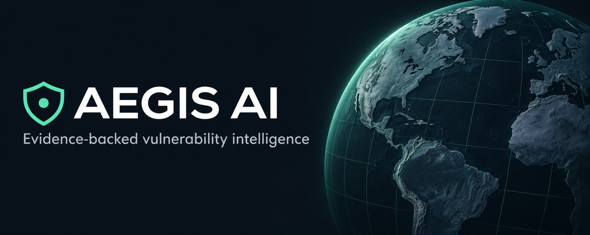

# AEGIS AI



**Inteligencia de vulnerabilidades respaldada por evidencia**

Presentación del producto y ficha técnica · AEGIS V2 · Noviembre de 2026

[English version](README.en.md) · [Descargar PDF en español](AEGIS-AI-ES.pdf)

**[Abrir AEGIS](https://aegis.oscarbahamonde.com/)** · **[Explorar el globo de exposición](https://aegis.oscarbahamonde.com/demo/exposure/)**

## Resumen del producto

AEGIS reúne información sobre vulnerabilidades de software en un espacio de trabajo
que ayuda a responder tres preguntas. **¿Qué merece atención primero? ¿Qué sabemos
con certeza? ¿Qué podemos hacer al respecto?** Cada investigación permite consultar
las fuentes que respaldan sus conclusiones.

### El problema

Los avisos de fabricantes, los registros de vulnerabilidades y las señales de
explotación suelen consultarse por separado. Una falla puede tener una gravedad alta,
una probabilidad estimada baja o evidencia de que ya se está explotando. Cada señal
sirve para una decisión distinta. Cuando esa información se combina sin conservar
su contexto, cuesta explicar por qué conviene atender un caso antes que otro.

### Cómo ayuda AEGIS

| Necesidad | Qué ofrece AEGIS |
| --- | --- |
| Decidir qué revisar primero | Un catálogo que distingue gravedad, probabilidad estimada y explotación conocida. |
| Entender el alcance de una falla | Una ficha con productos, versiones y debilidades relacionadas cuando la fuente las documenta. |
| Explicar una recomendación | Una investigación que enlaza la evidencia consultada y señala qué información falta. |
| Coordinar el siguiente paso | Un borrador de traspaso para que el equipo lo revise y comparta por su canal habitual. |

Está pensado para equipos de seguridad, infraestructura y gestión de riesgos.
Un analista puede revisar las fuentes y las versiones afectadas. Un responsable de
operaciones puede leer la recomendación, entender por qué importa y asignar el
siguiente paso.

### Un recorrido típico

1. Busca el identificador de una vulnerabilidad y abre su ficha.
2. Revisa qué productos podrían verse afectados, si hay explotación documentada
   y cómo ha cambiado la probabilidad estimada.
3. Lanza una investigación de mitigación y consulta el respaldo de cada recomendación.
4. Revisa el borrador y decide cómo escalar o compartir el caso.

El globo público permite explorar observaciones históricas de exposición por país.
La demo muestra la fuente, la fecha y la unidad de cada observación. **Sin datos**
significa que la muestra carece de evidencia para esa selección.
[Demo interactiva](https://aegis.oscarbahamonde.com/demo/exposure/) ·
[Publicación de Shadowserver](https://www.shadowserver.org/news/shadowserver-2025-highlights-of-the-year-in-review/)

---

## Ficha técnica

### Arquitectura y stack

| Componente | Tecnología | Función |
| --- | --- | --- |
| Interfaz | Nuxt 4, Vue 3, TypeScript, Tailwind y Vercel | Workspace, catálogo, visualizaciones y rutas de sesión en Nitro. |
| Ingesta y normalización | Python 3.12, Polars y PyArrow | Captura fuentes, valida esquemas y normaliza registros a Parquet. |
| Análisis local | DuckDB | Reproduce consultas sobre capturas fijadas y verifica resultados. |
| Plataforma de datos | Amazon S3, Apache Iceberg, AWS Glue y Athena | Conserva artefactos, versiona tablas y sirve lecturas analíticas. |
| API | FastAPI, Pydantic, API Gateway regional y AWS Lambda | Valida consultas, aplica autorización y transmite la respuesta. |
| Investigaciones | LangGraph, MCP, Amazon Bedrock y AgentCore | Orquesta lecturas de evidencia y valida el informe antes de emitirlo. |
| Identidad | OB Auth, Amazon Cognito y OAuth con PKCE S256 | Gestiona sesiones, verificación de correo y control de acceso. |
| Infraestructura y pruebas | AWS CDK, pytest, Ruff, mypy y Playwright | Define recursos y verifica contratos, tipos y recorridos de usuario. |

[Runbook de hosting](docs/hosting.md) · [Plataforma de datos](docs/v2-cloud-lakehouse.md) ·
[Contratos de consulta](docs/serving-contracts.md)

### Enfoque de datos e investigación

**Captura reproducible.** Se conservan la fecha de origen, los artefactos y sus
sumas de verificación. El catálogo unifica identificadores CVE y mantiene la
procedencia de las valoraciones. Las consultas y las investigaciones trabajan
sobre versiones fijadas de los datos, de modo que una actualización de una
fuente no altere la evidencia de una investigación en curso.

**Análisis con respaldo.** LangGraph planifica, recupera evidencia mediante
consultas tipadas, analiza y valida en cuatro pasos. Cuando se usa Bedrock,
el modelo selecciona afirmaciones entre hechos ya recuperados. El sistema
comprueba los identificadores de evidencia antes de emitir el informe. La
investigación comunica el progreso con SSE y admite cancelación y reanudación
del flujo por su propietario. El borrador de mitigación queda bajo revisión humana.
[Diseño de investigaciones](docs/g4-investigations.md)

**Acceso delimitado.** El workspace requiere una sesión válida de OB Auth.
Google requiere correo verificado. El acceso con correo y contraseña añade
un código de la aplicación autenticadora. La API aplica la pertenencia al
workspace y la propiedad de los recursos en el servidor. La demo geográfica
es pública. El catálogo y las investigaciones del workspace requieren sesión.
[Identidad y autorización](docs/identity-management.md)

### Fuentes y cobertura verificada

| Señal | Qué aporta | Alcance documentado |
| --- | --- | --- |
| CVE Program y NVD | Identidad, descripción, gravedad CVSS y condiciones de producto | 431.133 CVE distintas en el catálogo fijado. |
| FIRST EPSS | Probabilidad estimada de explotación en los próximos 30 días | 465.857.152 puntuaciones en 2.042 fechas disponibles entre 2021-04-14 y 2026-11-24. Nueve fechas faltan en la fuente. |
| CISA KEV | Evidencia de explotación conocida | Se conserva la procedencia de la inclusión de cada CVE. |
| Shadowserver | Exposición geográfica observada en una muestra histórica | Siete observaciones nacionales, cinco países y tres fechas de 2025. Cobertura parcial. |

CVSS describe gravedad. EPSS estima probabilidad. KEV registra explotación
conocida. El globo muestra observaciones geográficas según el alcance publicado.
La muestra de Shadowserver conserva los recuentos nacionales desconocidos y las
unidades originales. Sirve para explorar casos históricos con evidencia, con
cobertura parcial y sin inventario privado en la demo.
[Registro de fuentes](docs/source-register.md) · [Series temporales](docs/timeseries.md) ·
[Contrato geográfico](docs/geography-contract.md#demo-histórica-de-shadowserver)

### Verificación registrada

- **Producción, 26 de noviembre de 2026.** Chromium verificó el retorno de OB Auth,
  el dashboard, la lectura autenticada del catálogo y la denegación de la misma
  consulta tras cerrar sesión. Dos pruebas públicas cubrieron el globo y la lista
  móvil sin WebGL.
- **Regresión de la integración.** El registro del release documenta 92 pruebas
  de backend y cuatro pruebas de contrato de frontend, además de lint,
  comprobación de tipos y el build completo de Vercel.
- **Calidad de respuesta.** Una evaluación histórica con Nova Micro registró
  siete de siete afirmaciones respaldadas en dos investigaciones de mitigación.
  El resultado corresponde a esas ejecuciones y su evidencia fijada.

[Registro de publicación y aceptación](STATUS.md) · [Evaluación y mediciones](docs/evaluation.md)

## Desarrollo local

Usa Python 3.12 con `uv`, Node 22.22.3 y pnpm 10.32.1. El preflight comprueba
las herramientas del entorno macOS ARM64, incluido AWS CLI v2. Este recorrido
usa el conjunto local acotado de CISA KEV con enriquecimiento NVD.

```sh
make preflight
make bootstrap
make ingest-local
make validate-data
make smoke-local
make dev
```

FastAPI escucha en `http://127.0.0.1:8000`. Su documentación está en `/docs`
y MCP Streamable HTTP está en `/mcp/`. El servidor imprime la ruta de un token
de desarrollo de 15 minutos. Inicia Nuxt en otra terminal.

```sh
make frontend-install
NUXT_PUBLIC_LOCAL_TOKEN_AUTH=true sh scripts/frontend.sh dev
```

Abre `http://localhost:3000` e introduce el token de desarrollo. Para una
captura existente, selecciona su identificador con `SNAPSHOT=<run-uuid>` en
los comandos de Make compatibles. Las capturas y la evidencia local se
generan en `data/` por defecto. La aplicación alojada consulta el catálogo
y el histórico de producción en AWS.
[Configuración de ejemplo](.env.example) · [Ingesta V2](docs/v2-ingestion.md)

## Recursos y atribución

- [Guía de demostración](docs/final-demo.md) y [runbook de investigaciones](docs/g4-investigations.md).
- [Diccionario de datos](docs/data-dictionary.md) y [modelo de costos](docs/v2-cost-model.md).
- CISA KEV se distribuye bajo CC0-1.0. FIRST EPSS publica las puntuaciones con su
  atribución. AEGIS usa datos de la API de NVD sin aval ni certificación de NVD.
  [Licencia de KEV](https://github.com/cisagov/kev-data/blob/develop/LICENSE) ·
  [FIRST EPSS](https://www.first.org/epss/data) · [NVD](https://nvd.nist.gov/).
- Las observaciones geográficas públicas se atribuyen a The Shadowserver Foundation.
  [Fuente de la muestra](https://www.shadowserver.org/news/shadowserver-2025-highlights-of-the-year-in-review/).
