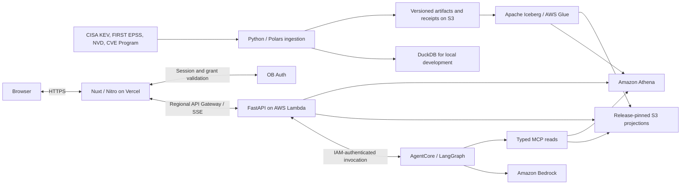

# AEGIS AI


AEGIS is a vulnerability intelligence workspace for triaging CVEs and investigating remediation with cited evidence. It combines known exploitation, historical EPSS scores, affected products and weaknesses, and geographic network context in a release-pinned workspace.

**[Open AEGIS V2](https://aegis.oscarbahamonde.com)** · [Local development](#local-development) · [Architecture](#architecture) · [Data and interpretation](#data-and-interpretation)

## What you can do

- **Triage vulnerabilities.** Search by CVE, inspect CISA KEV status and reported severity, and follow product and weakness relationships back to their sources.
- **Explore EPSS history.** Select a date range, inspect changes in exploitation probability, and see upstream gaps and model transitions.
- **Explore network context.** Switch between global WDI/ITU mobile subscription data and historical Canadian CRTC LTE population coverage. Each layer identifies its source and units.
- **Investigate remediation.** Start an investigation from a CVE, follow progress as it streams, and inspect the evidence behind the report. Review and edit a SOC/CSIRT handoff before sharing it yourself.

## Production access

[Sign in to AEGIS](https://aegis.oscarbahamonde.com/login) through OB Auth. Google sign-in requires a verified email. Email and password require a verified email and a TOTP code from an authenticator app. AEGIS checks workspace membership and resource ownership on the server. [OB Auth SDK](https://github.com/bahamondeX/ob-auth)

The production UI runs on Vercel and uses a regional AWS API Gateway for FastAPI and investigation streaming. The previous CloudFront workspace is retained for rollback. The verified cutover is recorded in commit `7aecbcc` on `v2-ob-auth-vercel`.

## Architecture



The four-node investigation workflow plans the request, retrieves bounded evidence, builds its analysis, and validates cited claims. The API streams progress and results over SSE. Investigations support cancellation and owner-scoped replay. The V2 serving layer reuses immutable inputs and pins the relevant Iceberg and S3 versions so a report can be traced to its source release.

## Data and interpretation

| Verified V2 release | Coverage |
| --- | --- |
| Vulnerability catalog | **431,133 distinct CVEs** across the pinned NVD and CVE Program captures |
| EPSS history | **465,857,152 scores** across **2,042 available dates** from April 14, 2021 through November 24, 2026. Nine upstream dates are absent. |
| WDI/ITU network context | **217 economies** in the reference dimension. **151** have a reported value for 2024. |
| Canadian CRTC network context | Historical **2021 LTE population coverage** at national, provincial and territorial levels |
| Geographic CVE exposure | **Unavailable** in the verified release. Private site and SOC incident layers are disabled. |

EPSS estimates the probability of exploitation activity over the next 30 days. KEV records vulnerabilities with evidence of known exploitation. CVSS describes severity. These metrics answer different questions and retain their source and date. WDI/ITU measures mobile subscriptions per 100 people and may exceed 100. CRTC measures the share of population covered by an LTE network. The map preserves the distinction between missing coverage and a measured zero. [Source register](docs/source-register.md) · [Data dictionary](docs/data-dictionary.md) · [Time-series rules](docs/timeseries.md)

## Local development

Use native Apple Silicon, Python 3.12 via `uv`, Node 22.22.3, pnpm 10.32.1, and AWS CLI v2 for the toolchain preflight. The local API runs against DuckDB. The quickstart captures the smaller KEV-focused development dataset with bounded NVD enrichment.

```sh
make preflight
make bootstrap
make ingest-local
make validate-data
make query-local
make smoke-local
```

To reuse a local capture, add `SNAPSHOT=<run-uuid>` to `validate-data`, `query-local`, `test`, `dev` or `verify-phase1`. Raw captures, Parquet, DuckDB and test evidence are generated under the Git-ignored `data/` directory by default. Optional source keys can go in the environment or a Git-ignored `.env` with mode `600`. Anonymous NVD access is supported. [.env.example](.env.example) · [Bulk V2 ingestion](docs/v2-ingestion.md)

### Run the local API

```sh
make dev
```

FastAPI listens at `http://127.0.0.1:8000`. Open `/docs` for the REST schema or use the Streamable HTTP MCP endpoint at `/mcp/`. The server writes a 15-minute development bearer token to `data/local-api.token` by default.

```sh
(printf 'Authorization: Bearer ' && cat data/local-api.token) |
  curl --noproxy '*' --fail --silent --show-error --header @- http://127.0.0.1:8000/v1/kpis
```

Run `make lint typecheck test` for the backend checks and `make smoke-investigation` for the pinned local investigation and SSE path. `make verify-phase1` replays the capture and compares generated Parquet checksums, counts and sampled DuckDB results.

### Run the V2 UI locally

Use a checkout containing the V2 release tree at `7aecbcc`. Run `make bootstrap`, `make ingest-local` and `make dev` there, or point that checkout at an existing local capture using `AEGIS_DATA_DIR` and `AEGIS_SNAPSHOT`. Start Nuxt in a second terminal in the same checkout.

```sh
make frontend-install
NUXT_PUBLIC_LOCAL_TOKEN_AUTH=true sh scripts/frontend.sh dev
```

Open `http://localhost:3000` and enter the development token written by the local API. The token path is printed when the API starts. The development UI uses the local snapshot. The hosted catalog and full EPSS archive are served from AWS.

## Verification and operations

The November 25, 2026 release record reports **106 Python tests and four frontend contract tests** passing. Hosted Chromium verified the production callback, the catalog and EPSS reads, logout and revocation, and eight ordered SSE events with a single terminal event. The recorded production investigation reached its first event in **1.545 s** and completed in **4.996 s**. Those timings describe one run.

| Topic | Reference |
| --- | --- |
| Release verification | [Execution history](STATUS.md) and [evaluation matrix](docs/evaluation.md). For the Vercel cutover entries, run `git show 7aecbcc:STATUS.md` and `git show 7aecbcc:docs/evaluation.md`. |
| Deployment, identity and rollback | [Hosting](docs/hosting.md) and [identity management](docs/identity-management.md). The Vercel and OB Auth procedures are in those files at `7aecbcc`. |
| Data and costs | [Cloud lakehouse](docs/v2-cloud-lakehouse.md), [serving contracts](docs/serving-contracts.md) and [cost model](docs/v2-cost-model.md) |
| Investigation and demo | [Investigation runbook](docs/g4-investigations.md), [demo script](docs/final-demo.md) and [technical case study](docs/case-study.md) |

## Source attribution

CISA KEV is distributed under CC0-1.0. EPSS scores are produced by Empirical Security and maintained by the FIRST EPSS SIG. This product uses data from the NVD API but is not endorsed or certified by the NVD. [KEV license](https://github.com/cisagov/kev-data/blob/develop/LICENSE) · [FIRST EPSS data](https://www.first.org/epss/data) · [NVD](https://nvd.nist.gov/)
