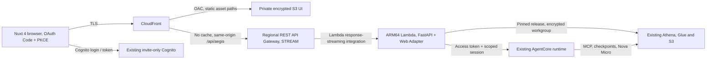

# G6 hosted workspace runbook

The remaining G6 stack is prepared locally. The existing Cognito and AgentCore
deployment is recorded in STATUS.md. The hosted UI, standalone API, and their
end-to-end cloud smoke require a separate approval and AWS deployment.

## Architecture



The local Nitro proxy remains useful for development. The hosted bundle uses
the same relative API path. CloudFront forwards the access token, query and
replay headers to a Regional REST API. The API uses AWS_PROXY with explicit
`STREAM` and the Lambda response-streaming invocation URI. The AWS Lambda Web
Adapter image is pinned to its Linux ARM64 digest. CloudFront compression and
caching are disabled on the API behavior and error TTLs are zero. A narrow edge
rewrite routes the Cognito callback to its prerendered static document. The
distribution uses managed HTTPS and requires no domain or DNS changes.
[API Gateway streaming](https://docs.aws.amazon.com/apigateway/latest/developerguide/response-transfer-mode-lambda.html) ·
[Web Adapter](https://github.com/aws/aws-lambda-web-adapter) ·
[S3 origin access control](https://docs.aws.amazon.com/AmazonCloudFront/latest/DeveloperGuide/private-content-restricting-access-to-s3.html)

Auth validates Cognito issuer, access-token type, app-client binding, expiry,
subject and workspace group at the API and again in AgentCore. Direct API
Gateway access has the same application checks. API reads use the exact
published Iceberg release. The relay forwards only allowlisted operations and
headers with short timeouts and streaming cleanup. AgentCore owns the journal,
idempotency, model allocation and explicit cancellation. A client disconnect
can close the relay while the managed AWS invocation finishes cancelling.
Test explicit cancel and disconnect separately.

API Gateway allows a 65-second stream and clips sustained or burst traffic.
The function has three reserved concurrent invocations, a 70-second timeout
and seven days of logs. Athena enforces the existing 64 MiB encrypted workgroup
cutoff. Calls consume the separate existing lakehouse, Bedrock and AgentCore
budgets. Use a finite pilot window and traffic limits. AWS billing can lag.

## Local verification

```sh
make synth-hosting
make build-ui-static
make smoke-ui-static
make test
```

Supply the existing public issuer, app-client ID and Cognito domain as
`NUXT_PUBLIC_COGNITO_ISSUER`, `NUXT_PUBLIC_COGNITO_CLIENT_ID` and
`NUXT_PUBLIC_COGNITO_DOMAIN`. The static build checks the workspace and
callback documents for the OIDC configuration. Upload only
`frontend/.output/public/` during an authorized deployment.
`data/hosting-cdk/` contains the local stack and ARM64 image asset.
The real-data loopback test exercises the start, cancellation, replay,
cross-workspace refusal and no-cache headers through the standalone relay.
It omits the managed Lambda/API Gateway/CloudFront transport.

## Separate authorization and deployment sequence

1. Obtain authorization for the hosted pilot, its USD ceiling, expiry and
   deployment plus rollback operations. Include the existing browser
   client's specific callback change, an AgentCore revision with scoped
   archive access for mitigation, ECR image publishing and any Canadian
   network companion publication. Keep the existing pool, app-client ID,
   checkpoints, model allocation, lakehouse and bootstrap assets.
2. Set the explicitly granted `AEGIS_HOSTING_APPROVAL` and
   `AEGIS_HOSTING_BUDGET_USD` in mode-600 local configuration. Run
   `make hosting-preflight` to validate the scope and STS account. Verify
   balances and quotas for all affected services. Inspect bootstrap role
   permissions, stack tags and ownership. Use a reviewed no-execute
   CloudFormation change set before executing any AWS change.
3. Build the ARM64 image and static bundle and stage the local CDK assembly.
   Resolve public Cognito and AgentCore outputs, the lake and results
   buckets, project KMS key and pinned release from the existing stacks.
   A CloudFront-origin override in the Cognito template is restricted to
   its exact CloudFront host. Review its change set for an in-place
   callback/list update and continued invite-only registration.
4. If network companion publication is approved, use the locally verified
   compact data blob and SHA-256, conditional S3 create, the existing KMS
   key and object SHA metadata. Use only
   `control/network/<release>/<sha256>.json` in the lake. Pass that exact
   digest as `NetworkContextDigest`. Empty digest reports unavailable
   network context on the hosted API. Review the image and AgentCore
   policy changes before deploying any new runtime revision.
5. Verify static distribution readiness and existing scheduler read-only
   state, published release and workgroup settings. Use two invited
   operator accounts and an unassigned account. In real Chromium, verify
   PKCE login, logout, expiry, memory-only tokens, API denial for wrong
   token or workspace, evidence, global/country/mitigation paths, ordered
   SSE first event before completion, ownership, replay and cancellation.
   Record cold and warm intervals, query scans, token usage and sanitized
   resource IDs. Disable temporary accounts after the run.
6. During an authorized rollback, stop only the pilot, remove its exact
   callback, and disable its CDN/API traffic. Inspect ownership before
   deleting anything. Keep the protected lake, identity, runtime,
   checkpoints and ECR assets outside an explicit scoped cleanup. The
   hosted UI bucket and seven-day log group use retention.

## Cost envelope for a bounded pilot

Illustrative `us-east-1` month, before taxes and with no free-tier credits.
Assume 1,000 API reads at 2 s and 50 streams at 35 s with 1 GiB of ARM64
Lambda, 10,000 viewer requests and 1 GB viewer transfer in the North
American price class. Assume 10,000 static origin reads, 100 writes,
0.1 GB static storage, 0.4 GB ECR storage and 0.1 GB logs.

| Component | Estimated USD |
| --- | ---: |
| Lambda requests and 3,750 GB-s | 0.051 |
| 1,050 API Gateway requests and up to 0.1 GB API transfer | 0.013 |
| CloudFront viewer traffic and function | 0.096 |
| S3 UI storage and operations | 0.007 |
| ECR image storage | 0.040 |
| CloudWatch log ingestion and retention | 0.053 |
| **New hosting services, rounded up** | **0.27** |

Athena, existing S3/KMS, AgentCore and Bedrock are separate. For 1,600 Athena
statements at the existing 64 MiB cap, the worst-case scan estimate is
USD 0.537 at USD 5 per TB, before any triggered data-service operations.
Count actual queries, because a UI operation can use several statements.
Inbound throttles, reserved concurrency and query bounds limit work. They
do not cap the bill. No new hosting expenditure has been approved.
[AWS Lambda pricing](https://aws.amazon.com/lambda/pricing/) ·
[API Gateway pricing](https://aws.amazon.com/api-gateway/pricing/) ·
[CloudFront pricing](https://aws.amazon.com/cloudfront/pricing/pay-as-you-go/) ·
[S3 pricing](https://aws.amazon.com/s3/pricing/) ·
[ECR pricing](https://aws.amazon.com/ecr/pricing/) ·
[CloudWatch pricing](https://aws.amazon.com/cloudwatch/pricing/)
