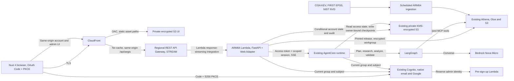

# G6 hosted workspace runbook

The hosted workspace uses the existing Cognito directory, AgentCore runtime and
lake. The deployment scope and measured outcomes are recorded in [STATUS.md](../STATUS.md).

## Architecture



The local Nitro proxy remains useful for development. The hosted bundle uses
the same relative API path. CloudFront forwards the access token, query and
replay headers to a Regional REST API. The API uses AWS_PROXY with explicit
`STREAM` and the Lambda response-streaming invocation URI. The AWS Lambda Web
Adapter image is pinned to its Linux ARM64 digest. CloudFront compression and
caching are disabled on the API behavior and error TTLs are zero. A narrow edge
rewrite routes the Cognito callback to its prerendered static document. The
distribution uses managed HTTPS and requires no domain or DNS changes.
[API Gateway streaming](https://docs.aws.amazon.com/apigateway/latest/developerguide/response-transfer-mode-lambda.html) ·
[Web Adapter](https://github.com/aws/aws-lambda-web-adapter) ·
[S3 origin access control](https://docs.aws.amazon.com/AmazonCloudFront/latest/DeveloperGuide/private-content-restricting-access-to-s3.html)

Auth validates the Cognito issuer, signature, access-token type, app-client
binding, expiry and subject at both the API and AgentCore. The current state
resolves workspace permission on every protected operation. Direct API
Gateway access has the same application checks. API reads use the exact
published Iceberg release. The relay forwards only allowlisted operations and
headers with short timeouts and streaming cleanup. AgentCore owns the journal,
idempotency, model allocation and explicit cancellation. A client disconnect
can close the relay while the managed AWS invocation finishes cancelling.
Test explicit cancel and disconnect separately.

API Gateway allows a 65-second stream and clips sustained or burst traffic.
CloudFront permits up to 60 seconds between origin response packets.
The function has 1.5 GiB, three reserved concurrent invocations, a 70-second timeout
and seven days of logs. Athena enforces the existing 64 MiB encrypted workgroup
cutoff. Calls consume the separate existing lakehouse, Bedrock and AgentCore
budgets. Use a finite pilot window and traffic limits. AWS billing can lag.

## Local verification

```sh
make synth-hosting
make build-ui-static
make smoke-ui-static
make test
```

Supply the existing public issuer, app-client ID and Cognito domain as
`NUXT_PUBLIC_COGNITO_ISSUER`, `NUXT_PUBLIC_COGNITO_CLIENT_ID` and
`NUXT_PUBLIC_COGNITO_DOMAIN`. The static build checks the workspace and
callback documents for the OIDC configuration. Upload only
`frontend/.output/public/` during an authorized deployment.
`data/hosting-cdk/` contains the local stack and ARM64 image asset.
The real-data loopback test exercises the start, cancellation, replay,
cross-workspace refusal and no-cache headers through the standalone relay.
It omits the managed Lambda/API Gateway/CloudFront transport.

## Separate authorization and deployment sequence

1. Verify the scoped approval, STS account, stack ownership, quotas, billing
   estimates and inference ledgers. Run `make hosting-preflight`, `make synth-agent`
   and `make synth-hosting`. Review CDK live diff and no-execute change sets for all
   three stacks. Preserve the existing physical pool and browser client.
2. Update AgentCore before enabling public registration, so approval is
   enforced on the direct runtime. Run `make deploy-agent`. Deploy the
   standalone API and distribution with `make deploy-hosting`. The command
   verifies the companion manifest and conditionally stores the Canadian
   context under `control/network/<release>/<sha256>.json`.
3. Reconcile the existing Google mapping using the scoped
   `infra.hosting_deploy google-mapping` operation. It retains the existing
   provider credentials. Use `infra.agent_deploy identity --hosted-origin
   <assigned-CloudFront-origin> --enable-google` with the owned distribution
   origin. Omit the Google flag when the provider is unavailable. The command
   never permits a replacement pool or client.
4. Run `make deploy-ui` to generate and upload public Nuxt static files.
   Use the assigned CloudFront URL. `make smoke-cloud` uses scoped temporary
   operator identities and disables them after execution. Carry out native
   email, federated, administrator approval and recovery acceptance
   separately with the interactive onboarding procedure.
   [Identity runbook](identity-management.md)
5. During authorized rollback, close public registration, disable the
   pilot's traffic, and remove its exact hosted callback. Review the
   CloudFormation changes for the project first. Retain the lake, existing
   runtime, encrypted checkpoint and decision history, and retained logs
   and UI objects. Irreversible data or identity deletion needs separate
   authorization. Retained resource charges should be reconciled after
   teardown. [Lakehouse runbook](lakehouse.md)

## Cost envelope for a bounded pilot

Illustrative `us-east-1` month, before taxes and with no free-tier credits.
Assume 1,000 API reads at 2 s and 50 streams at 35 s with 1.5 GiB of ARM64
Lambda, 10,000 viewer requests and 1 GB viewer transfer in the North
American price class. Assume 10,000 static origin reads, 100 writes,
0.1 GB static storage, 0.4 GB ECR storage and 0.1 GB logs.

| Component | Estimated USD |
| --- | ---: |
| Lambda requests and 5,625 GB-s | 0.077 |
| 1,050 API Gateway requests and up to 0.1 GB API transfer | 0.013 |
| CloudFront viewer traffic and function | 0.096 |
| S3 UI storage and operations | 0.007 |
| ECR image storage | 0.040 |
| CloudWatch log ingestion and retention | 0.053 |
| **New hosting services, rounded up** | **0.30** |

Athena, existing S3/KMS, AgentCore and Bedrock are separate. For 1,600 Athena
statements at the existing 64 MiB cap, the worst-case scan estimate is
USD 0.537 at USD 5 per TB, before any triggered data-service operations.
Count actual queries, because a UI operation can use several statements.
Inbound throttles, reserved concurrency and query bounds limit work. They
do not cap the bill. The authorized hosting and identity ceiling is USD 5. The rollout reserves
USD 1 for the USD 0.30 modeled hosting month and bounded Cognito, guard Lambda,
email, S3 and deployment requests. The estimate assumes negligible traffic
outside validation. Cost Explorer may apply credits, delay usage attribution
or show costs from unrelated project resources. Read the relevant account
usage categories before further deployments. Review actual traffic and
remaining scoped balances before extending the validation window.
[AWS Lambda pricing](https://aws.amazon.com/lambda/pricing/) ·
[API Gateway pricing](https://aws.amazon.com/api-gateway/pricing/) ·
[CloudFront pricing](https://aws.amazon.com/cloudfront/pricing/pay-as-you-go/) ·
[S3 pricing](https://aws.amazon.com/s3/pricing/) ·
[ECR pricing](https://aws.amazon.com/ecr/pricing/) ·
[CloudWatch pricing](https://aws.amazon.com/cloudwatch/pricing/)
