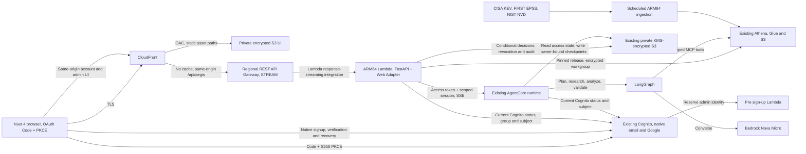

# G6 hosted workspace runbook

## Vercel and the regional V2 API

Production is [aegis.oscarbahamonde.com](https://aegis.oscarbahamonde.com)
on project `aegis`. Vercel serves deployment `dpl_AuZYv1sVrAhmcaYbS3iZDewE66f8`.
The stable Preview at [aegis-candidate.vercel.app](https://aegis-candidate.vercel.app)
uses the separate `aegis-candidate` OB Auth registration. The reviewed AWS
updates are applied and AgentCore DEFAULT is version 8. The
[acceptance record](../STATUS.md) includes the hosted provider checks and the
Chromium run on the final domain.

The Vercel project uses root directory `frontend`, framework Nuxt, Node 22.x and
the exact pnpm version in `package.json`. The local Node patch is 22.22.3.
`frontend/vercel.json` installs with the frozen lockfile and runs
`nuxt build`. The generated Nitro functions advertise response streaming.
Set `NUXT_AEGIS_API_BASE` to
`https://4t3oopwwc2.execute-api.us-east-1.amazonaws.com/pilot/` and enable
the pinned V2 history, profiles, catalog and network flags for the build.
Configure the private OB Auth values independently by environment.
[Identity runbook](identity-management.md)

### AWS review and activation

The OB Auth variant reuses the existing `aegis-dev-hosting-v2-preview`
regional REST API and `aegis-dev-agent-v2-preview` runtime. Their legacy
V2 templates, parameter values and outputs were captured under
`data/evidence/v2-ob-auth-vercel/aws-rollback/`. The existing primary
CloudFront application continues to use the original hosting and runtime
stacks and remains available as a rollback path.

From the OB Auth worktree, verify profile `default`, account ending
`6271`, region `us-east-1`, the owning stack tags and applicable
hosting/model budgets before publishing assets or executing a change set.
Synth and diff both assemblies against the current stacks.

```sh
uv run --locked --no-sync python -m infra.agentcore_stack --ob-auth --outdir "$agent_assembly"
uv run --locked --no-sync python -m infra.hosting_stack --v2 --preview --ob-auth --out "$hosting_assembly"
cdk diff --app "$agent_assembly" --method template --profile default
cdk diff --app "$hosting_assembly" --method template --profile default
```

Review the no-execute changes in
`data/evidence/v2-ob-auth-vercel/aws-change-sets.json`. Preserve every
deployed release pin, including the committed EPSS snapshot
`5416157301492221669`. The proposed API update is in place. CloudFormation
reported conditional recreation of two Lambda invoke permissions because
they reference the Lambda ARN. The AgentCore change adds its scoped IAM
role and updates the existing runtime in place. The lake, Cognito pools,
KMS key, distribution and checkpoint bucket are outside both change sets.
The image tags and verified digests for these change sets are recorded in
`data/evidence/v2-ob-auth-vercel/aws-assets.json`.

Prepare the encrypted bridge parameter and confirm the candidate's
relying-party registration before deploying the candidate. Add its
separate production credentials only when staging the production build.
Publish the reviewed ARM64 image assets only to the owned
CDK ECR repository. Revalidate the original stack parameters and review
the exact image digests and change sets. Apply the AgentCore change first
and verify DEFAULT is READY with IAM authentication. Apply the API change
and test revocation, access from the runtime, and retired preview versions
before opening the candidate. The previous CloudFront preview UI expects
its original authentication mode and will need its saved templates to
serve as a V2 rollback.

### Candidate, promotion and rollback

Use an exact, stable Vercel candidate origin and a separate OB Auth
client. Complete the identity checklist, real AWS catalog and EPSS reads,
and browser SSE acceptance before staging production. Record first and
last event times, sequence continuity, a single terminal event, active
cancellation and owner-scoped replay. Exercise an authenticated regional
connection if the Nitro relay buffers or truncates events. Any direct
browser connection requires an exact CORS allowlist.

Capture the current Vercel production deployment ID, authoritative DNS
records and TTL, and the two AWS rollback receipts. Stage the production
build with production environment values and domain assignment deferred.
Add only the exact AEGIS subdomain to the project. Use the DNS target
Vercel supplies for the attached project, verify both authoritative
nameservers and HTTPS, and then promote the reviewed build. Validate
Chromium on the exact domain with the production callback, real AWS data,
streaming and logout. Record browser requests to the app and the Nitro
upstream destination so CloudFront can be excluded from the serving path.

If a compatible Vercel production build exists, reassign the production
alias to that deployment after verifying its canonical origin, credentials
and regional bridge compatibility. This was the first production deployment
for `aegis`. The prior Preview `dpl_DZE6xz2g5Jd583rmr7Bwv2axNM8X` has
candidate credentials. The existing release for immediate fallback is
[the legacy workspace](https://d13u8qrh8t434t.cloudfront.net/). Verify it
before redirecting users and disable the `aegis` OB Auth client if withdrawing
the new public origin.

For an AWS rollback, create and review an update from the saved templates,
parameters and original V2 image tags. Restore AgentCore DEFAULT first,
then the hosting Lambda, and verify the selected release. Refer to the
rollback receipts and the previous `ObBridgeParameter` in
`data/evidence/v2-ob-auth-vercel/google-policy/release-evidence.json`.

For DNS rollback, verify the current record ID, value and zone against the
cutover receipt. The baseline had no `aegis` record. If restoring that
baseline, remove CNAME `22681` (`aegis`,
`526db338f6099a35.vercel-dns-017.com`) and the AEGIS verification TXT
`22680` (`_vercel`, `vc-domain-verify=aegis.oscarbahamonde.com,8588fb5c26443c8788f5`).
Both use TTL 600. Confirm the result on both authoritative servers and a
recursive resolver. Keep the legacy distribution until the rollback window
closes and its removal is separately authorized.

The hosted workspace uses the existing Cognito directory, AgentCore runtime and
lake. The deployment scope and measured outcomes are recorded in [STATUS.md](../STATUS.md).

## Architecture



The local Nitro proxy remains useful for development. The hosted bundle uses
the same relative API path. CloudFront forwards the access token, query and
replay headers to a Regional REST API. The API uses AWS_PROXY with explicit
`STREAM` and the Lambda response-streaming invocation URI. The AWS Lambda Web
Adapter image is pinned to its Linux ARM64 digest. CloudFront compression and
caching are disabled on the API behavior and error TTLs are zero. A narrow edge
rewrite routes the Cognito callback to its prerendered static document. The
distribution uses managed HTTPS and requires no domain or DNS changes.
[API Gateway streaming](https://docs.aws.amazon.com/apigateway/latest/developerguide/response-transfer-mode-lambda.html) ·
[Web Adapter](https://github.com/aws/aws-lambda-web-adapter) ·
[S3 origin access control](https://docs.aws.amazon.com/AmazonCloudFront/latest/DeveloperGuide/private-content-restricting-access-to-s3.html)

Auth validates the Cognito issuer, signature, access-token type, app-client
binding, expiry and subject at both the API and AgentCore. The current state
resolves workspace permission on every protected operation. Direct API
Gateway access has the same application checks. API reads use the exact
published Iceberg release. The relay forwards only allowlisted operations and
headers with short timeouts and streaming cleanup. AgentCore owns the journal,
idempotency, model allocation and explicit cancellation. A client disconnect
can close the relay while the managed AWS invocation finishes cancelling.
Test explicit cancel and disconnect separately.

API Gateway allows a 65-second stream and clips sustained or burst traffic.
CloudFront permits up to 60 seconds between origin response packets.
The function has 1.5 GiB, three reserved concurrent invocations, a 70-second timeout
and seven days of logs. Athena enforces the existing 64 MiB encrypted workgroup
cutoff. Calls consume the separate existing lakehouse, Bedrock and AgentCore
budgets. Use a finite pilot window and traffic limits. AWS billing can lag.

## Local verification

```sh
make synth-hosting
make build-ui-static
make smoke-ui-static
make test
```

Supply the existing public issuer, app-client ID and Cognito domain as
`NUXT_PUBLIC_COGNITO_ISSUER`, `NUXT_PUBLIC_COGNITO_CLIENT_ID` and
`NUXT_PUBLIC_COGNITO_DOMAIN`. The static build checks the workspace and
callback documents for the OIDC configuration. Upload only
`frontend/.output/public/` during an authorized deployment.
`data/hosting-cdk/` contains the local stack and ARM64 image asset.
The real-data loopback test exercises the start, cancellation, replay,
cross-workspace refusal and no-cache headers through the standalone relay.
It omits the managed Lambda/API Gateway/CloudFront transport.

## Separate authorization and deployment sequence

1. Verify the scoped approval, STS account, stack ownership, quotas, billing
   estimates and inference ledgers. Run `make hosting-preflight`, `make synth-agent`
   and `make synth-hosting`. Review CDK live diff and no-execute change sets for all
   three stacks. Preserve the existing physical pool and browser client.
2. Update AgentCore before enabling public registration, so approval is
   enforced on the direct runtime. Run `make deploy-agent`. Deploy the
   standalone API and distribution with `make deploy-hosting`. The command
   verifies the companion manifest and conditionally stores the Canadian
   context under `control/network/<release>/<sha256>.json`.
3. Reconcile the existing Google mapping using the scoped
   `infra.hosting_deploy google-mapping` operation. It retains the existing
   provider credentials. Use `infra.agent_deploy identity --hosted-origin
   <assigned-CloudFront-origin> --enable-google` with the owned distribution
   origin. Omit the Google flag when the provider is unavailable. The command
   never permits a replacement pool or client.
4. Run `make deploy-ui` to generate and upload public Nuxt static files.
   Use the assigned CloudFront URL. `make smoke-cloud` uses scoped temporary
   operator identities and disables them after execution. Carry out native
   email, federated, administrator approval and recovery acceptance
   separately with the interactive onboarding procedure.
   [Identity runbook](identity-management.md)
5. During authorized rollback, close public registration, disable the
   pilot's traffic, and remove its exact hosted callback. Review the
   CloudFormation changes for the project first. Retain the lake, existing
   runtime, encrypted checkpoint and decision history, and retained logs
   and UI objects. Irreversible data or identity deletion needs separate
   authorization. Retained resource charges should be reconciled after
   teardown. [Lakehouse runbook](lakehouse.md)

## Production validation evidence

Run the combined Chromium smoke once per bounded validation attempt.
Provide `--evidence-dir` to `scripts.smoke_cloud` to retain captures from
previous runs. The wrapper verifies the owned deployment and cleans up
its fixture cohort. If the AWS operator session expires during a run,
renew it using the same scoped profile before invoking
`python -m scripts.agent_identity_fixture disable --hosted`. Verify the
saved Cognito creation and disable receipts for the exact subjects.
Keep the mode-600 fixture manifest until the disable operation confirms
the directory state. A browser test exit alone cannot establish cleanup.

The 24 November 2026 combined run passed all three Chromium tests and
captured the hosted map, graph, CVE detail and live mitigation report.
The current gates and the separate mailbox, Google and administrative
checks are tracked in the [evaluation report](evaluation.md).

## Cost envelope for a bounded pilot

Illustrative `us-east-1` month, before taxes and with no free-tier credits.
Assume 1,000 API reads at 2 s and 50 streams at 35 s with 1.5 GiB of ARM64
Lambda, 10,000 viewer requests and 1 GB viewer transfer in the North
American price class. Assume 10,000 static origin reads, 100 writes,
0.1 GB static storage, 0.4 GB ECR storage and 0.1 GB logs.

| Component | Estimated USD |
| --- | ---: |
| Lambda requests and 5,625 GB-s | 0.077 |
| 1,050 API Gateway requests and up to 0.1 GB API transfer | 0.013 |
| CloudFront viewer traffic and function | 0.096 |
| S3 UI storage and operations | 0.007 |
| ECR image storage | 0.040 |
| CloudWatch log ingestion and retention | 0.053 |
| **New hosting services, rounded up** | **0.30** |

Athena, existing S3/KMS, AgentCore and Bedrock are separate. For 1,600 Athena
statements at the existing 64 MiB cap, the worst-case scan estimate is
USD 0.537 at USD 5 per TB, before any triggered data-service operations.
Count actual queries, because a UI operation can use several statements.
Inbound throttles, reserved concurrency and query bounds limit work. They
do not cap the bill. The authorized hosting and identity ceiling is USD 5. The rollout reserves
USD 1 for the USD 0.30 modeled hosting month and bounded Cognito, guard Lambda,
email, S3 and deployment requests. The estimate assumes negligible traffic
outside validation. Cost Explorer may apply credits, delay usage attribution
or show costs from unrelated project resources. Read the relevant account
usage categories before further deployments. Review actual traffic and
remaining scoped balances before extending the validation window.
[AWS Lambda pricing](https://aws.amazon.com/lambda/pricing/) ·
[API Gateway pricing](https://aws.amazon.com/api-gateway/pricing/) ·
[CloudFront pricing](https://aws.amazon.com/cloudfront/pricing/pay-as-you-go/) ·
[S3 pricing](https://aws.amazon.com/s3/pricing/) ·
[ECR pricing](https://aws.amazon.com/ecr/pricing/) ·
[CloudWatch pricing](https://aws.amazon.com/cloudwatch/pricing/)

## V2 release lane

The current deployed MVP and its pinned release remain the fallback.
The V2 worker assembly uses a separate stack with a reviewed EPSS window.
It does not contain the existing scheduler, CloudFront or identity stack.
Review the [V2 cloud lakehouse](v2-cloud-lakehouse.md) and [cost scopes](v2-cost-model.md)
before any authorized canary. Cloud publication requires actual STS scope,
object and table validation, a live change set, a tested rollback pointer
and authenticated browser acceptance of the combined V2 release. The
remaining MVP identity acceptance and cleanup are tracked in [STATUS](../STATUS.md).

## V2 validation and promotion

The release pins file records the reviewed network, catalog, profile and
EPSS history digests. The first V2 validation stack uses a dedicated
CloudFront distribution and Lambda API. Its isolated AgentCore runtime
uses the owned checkpoint bucket, Cognito client and model ledger. The
existing data and identity subject IDs continue to apply. Athena continues to enforce the existing 64 MiB cutoff.

Set the project data directory and the pinned baseline snapshot UUID before
running these commands from the release worktree. Use the evidence folder
recorded in STATUS.md and keep all authentication inputs private.

```sh
export JSII_RUNTIME_PACKAGE_CACHE=disabled
export AEGIS_DATA_DIR=/Users/oscarbahamonde/Desktop/aegis-ai/data
export AEGIS_SNAPSHOT=4e13ca6b-c2e1-4407-88bc-c362da7dbacb
evidence="$AEGIS_DATA_DIR/evidence/v2-production-20261124"
pins="$evidence/v2-pins.json"

uv run --locked --no-sync python -m infra.hosting_deploy review \
  --preview --v2-agent --v2-pins "$pins" --assembly "$evidence/cdk-preview-history-agent"
uv run --locked --no-sync python -m scripts.smoke_cloud \
  --preview --history-agent --evidence-dir "$evidence/hosted-review"
```

Complete the mandatory hosted identity cases in the candidate URL. Use a
disposable native address with mailbox access and a separate disposable
Google identity. Enter credentials and verification codes directly in the
browser. Record the created Cognito subject and provider before taking any
administrative action. A different registrant is needed for the rejection
case. The approved test account must exercise suspension, old-session
denial, restoration and a fresh sign-in. Verify the actor, target, UTC
timestamp and outcome in the administrative audit. Preserve the permanent
administrator, and verify disablement of the exact test subjects.

The V2 production command requires an acceptance receipt with the candidate
URL, pins, deployed API image digest, static artifact checksum and outcomes
for every mandatory criterion. Keep the accepted static directory and CDK
assembly as delivered. Review the production change set first.

```sh
uv run --locked --no-sync python -m infra.hosting_deploy review \
  --v2-agent --v2-pins "$pins" --assembly "$evidence/cdk-production-history-agent"
uv run --locked --no-sync python -m infra.hosting_deploy deploy \
  --v2-agent --v2-pins "$pins" --assembly "$evidence/cdk-production-history-agent" \
  --acceptance "$evidence/hosted-acceptance.json"
uv run --locked --no-sync python -m infra.hosting_deploy publish-ui \
  --v2-agent --v2-pins "$pins" --acceptance "$evidence/hosted-acceptance.json" \
  --static-artifact "$evidence/accepted-static-history-agent"
uv run --locked --no-sync python -m scripts.smoke_cloud \
  --v2 --history-agent --evidence-dir "$evidence/production-post-promotion"
```

On a failed production smoke, restore the exact saved CloudFormation
template and parameters and the prior versioned S3 assets. Capture the
baseline again in a new directory just before any future promotion if the
production resources have advanced since the saved capture.

```sh
uv run --locked --no-sync python -m infra.v2_hosting_rollback restore \
  "$evidence/rollback-baseline"
uv run --locked --no-sync python -m scripts.smoke_cloud \
  --evidence-dir "$evidence/production-after-rollback"
```
