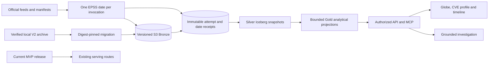

# V2 cloud ingestion and lakehouse

## Architecture



The local storage adapter exercises the same publication protocol as S3.
S3 is the proposed durable authority for V2. One temporary file and one
normalized partition are sufficient for an EPSS invocation. The worker
reads a reviewed daily member, verifies the official Git blob fingerprint,
uses the existing EPSS normalizer, and publishes a date receipt after
both artifacts are durable. A new plan can reuse an imported date when
the upstream blob is identical. The launch lane is an isolated on-demand
worker and has no scheduler resources.

## Bronze key and integrity contract

Use `v2/bronze/<source>/<artifact-class>/<sha256>` for content.
Source classes include `kev`, `kev-history`, `nvd`, `cve-program`, `epss`
and `network`. CPE, geographic observations and mitigation can use the
same addressing once independently verified. The manifest namespace
holds source plans, published migration inventories, date receipts and
attempt records.

Artifact status is determined by committed receipts. A reserved attempt
without an outcome is visible to an operator as interrupted or in progress.
Source bytes and normalized bytes are separate immutable objects. The sender
supplies SHA-256, expected bucket owner, SSE-KMS key and conditional
`If-None-Match`. A post-write HEAD checks full SHA-256, size, encryption and
version. READ verifies small control records and closes its response body.
Local writes use a temporary file followed by a no-replace hard link.

All measured compressed source artifacts fit within the current 1 GiB
single-PUT input bound. A PUT exposes the object only on completion, so
individual partial multipart uploads are absent from this path. A normalized
object written without a final receipt remains unreferenced and is safe to
reuse on a separately authorized retry. Larger future files need
multipart staging, per-part checksum validation, abort or lifecycle cleanup
for incomplete uploads, and independent full-byte SHA-256 verification.
Multipart ETags cannot provide that verification.
[S3 full-object checksums](https://docs.aws.amazon.com/AmazonS3/latest/userguide/checking-object-integrity.html) ·
[Conditional writes](https://docs.aws.amazon.com/AmazonS3/latest/userguide/conditional-writes.html)

## Operator sequence

1. Dry-run `python -m pipelines.bronze_migrate` against verified V2 local
   receipts. The tool checks local raw and Parquet SHA-256, bytes and row totals.
   It enumerates historical KEV revisions from the pinned Git objects and
   includes the EPSS official tree manifest. The malformed KEV commit stays
   recorded in history. Its raw body is outside the verified migration set.
2. Review the exact inventory ID and the [cost model](v2-cost-model.md).
   The cloud apply requires `--apply <inventory-id>` and the explicitly
   authorized `AEGIS_V2_MIGRATION_APPROVAL`, `AEGIS_V2_MIGRATION_USD`,
   `AEGIS_V2_MIGRATION_BYTES` and `AEGIS_V2_MIGRATION_OBJECTS`. The approval
   has shape `<account>/<region>/<project>/bronze-migration/<inventory-id>`.
   The configured profile must pass STS. Stack tags and outputs, expected bucket
   owner, versioning and KMS region/account must match before writes.
3. Dry-run an `epss_bronze plan` from a pinned official tree with a calendar
   window of at most 32 dates. Publish the reviewed digest with
   `plan --publish <digest>` under separately authorized
   `AEGIS_V2_EPSS_PLAN_APPROVAL=<account>/<region>/<project>/epss-plan/<digest>`
   and `AEGIS_V2_EPSS_PLAN_USD`. Prepare the isolated CDK assembly with
   `JSII_RUNTIME_PACKAGE_CACHE=disabled AEGIS_CDK_OFFLINE=1 CDK_OUTDIR=data/v2-cloud-cdk uv run --locked --no-sync python -m infra.v2_ingest_stack`.
4. After approval and a real change-set review, pass the verified existing
   lake bucket, KMS key and approved plan digest as stack parameters
   `LakeBucket`, `LakeKeyArn` and `ApprovedPlanDigest`. The proposed worker
   invokes with a named digest, date and attempt number. It checks the Lambda
   account/region and actual STS account. First verify a migrated date, then
   verify a new date and replay it. Advance at most three explicit attempts
   per date and track the durable receipt after each invocation.
5. Compare remote version ID, checksum, row counts, source date and normalized
   Parquet against the planned receipt before authorizing another window.
   Measure elapsed time, temporary artifact bytes, peak RSS, S3 and KMS
   requests, and actual costs. Keep the current six-hour MVP scheduler at its
   existing cadence. A V2 scheduler is a later acceptance step.
6. Reclaiming local disk requires explicit approval of the exact files.
   Export the committed remote receipt, verify version IDs and checksums
   again, and test retrieval of a representative raw and Parquet artifact.
   Remove only approved verified copies. Deletion is a distinct operation.

## Format-specific continuation

EPSS is independently gzip-compressed per day. NVD is independently
compressed per annual/revision feed. Capture each whole file once, stream the
nested array for normalization, and reconcile per-file checkpoints. The
CVE Program baseline is a nested ZIP. Its central directory requires seekable
input and the inner ZIP uses bounded scratch; subsequent releases use
cumulative deltas. KEV uses small current JSON and immutable revision objects.
CPE Dictionary and CPE Match are separate sizing pilots. CPE Match requires
additional scratch and a measured stream-to-shards normalization plan before
selecting Lambda, Glue or a temporary container. Arbitrary compressed byte
ranges do not form independent processing units.

Silver and Gold releases use a separate manifest after table versions and
validation are complete. Preserve the existing eight-table MVP pointer.
Retention must account for every Iceberg snapshot required by a published
release. The current Bronze worker publishes verified date receipts. Glue
registration, Athena parity, V2 scheduling and the production pointer
remain later acceptance steps.

## Local EPSS Silver component

The local PyIceberg catalog appends one accepted date at a time, sorts
its data by CVE and validates the resulting day counts in DuckDB. The
component stores the exact Iceberg snapshot and table identity after
validation, alongside its verified Bronze plan. A retry can reuse a
completed component. Queries on earlier pinned snapshots survive new
date writes. This component does not activate a global V2 release.

Reproduce the canary using a local Bronze plan whose requested members
are all committed.

```sh
uv run --locked --no-sync python -m pipelines.v2_history \
  --local-store data/v2-cloud-canary --warehouse data/v2-silver-canary \
  publish --plan <verified-plan-digest>
```

For S3 Bronze inputs, the storage interface supports a version-pinned
streaming read and verifies its bytes against the receipt. An eventual
Silver role will need prefix-scoped `s3:GetObjectVersion`, KMS access and
separate table-write permissions. The current EPSS Bronze Lambda role
has no Glue or Athena write authority.

[Data dictionary](data-dictionary.md) · [Temporal rules](timeseries.md) ·
[Serving contracts](serving-contracts.md)

## Staging EPSS in the existing Glue database

The two-date staging component uses `aegis_dev.fact_epss_daily` in a dedicated
`v2/silver/` location. Reproduce its verification with
`python -m scripts.verify_v2_silver --evidence data/evidence/v2-activation`.
The operator requires the passed AWS canary, verifies the existing encrypted
Athena workgroup, and reserves each attempt before writes. A committed
receipt replays without running more Athena queries. The receipt binds the
versioned Gold daily Parquet to the Iceberg snapshot. Its staging visibility
leaves the active MVP release pointer outside the operation.

The verification uses a finite set of date-filtered queries. Counting
records alone allows Athena to answer from metadata. The threshold aggregate
forces column reads so the two-date and single-date scans can be compared.
See [the measured parity and scan results](../STATUS.md).

## Historical EPSS campaign

`scripts.v2_epss_campaign plan` compares a verified official archive tree with
the versioned S3 date receipts. It writes a local bundle with the official
denominator, absent dates, each window digest, only the missing members to
dispatch, and per-member size limits. Review the bundle and bind
`AEGIS_V2_HISTORY_APPROVAL` to
`<account>/<region>/<project>/epss-history/<campaign-digest>`.
`AEGIS_V2_HISTORY_USD`, the initial allocations, and the overall one-time
ceiling guard publication and execution.

`publish` verifies every window against the source tree, writes the immutable
window receipts and commits the campaign last. Synthesize the existing
worker stack with `AEGIS_CDK_V2_HISTORY=1` and `ApprovedCampaignDigest`.
Review a live change set for in-place worker and policy updates before
execution. The manually triggered function has four reserved concurrent
invocations and preserves the existing 120-second, 1 GiB runtime bounds.

```sh
uv run --locked --no-sync python -m scripts.v2_epss_campaign plan \
  --tree <official-tree.json> --bundle <reviewed-bundle.json>
uv run --locked --no-sync python -m scripts.v2_epss_campaign publish \
  --tree <official-tree.json> --bundle <reviewed-bundle.json>
uv run --locked --no-sync python -m scripts.v2_epss_campaign run \
  --bundle <reviewed-bundle.json> --limit 8
```

Review the measured initial dates before dispatching a larger tranche.
The coordinator reserves each dispatch in S3. The worker accepts only
reserved days in approved windows and verifies actual source bytes. After
an interruption, the coordinator reuses committed dates. Inspect each
unsettled dispatch before reserving its next attempt. The `--since` and
`--limit` options can isolate a specific date. Each attempt has one durable
dispatch record, and the campaign caps each date at three reservations.

Once all date receipts are present, `scripts.v2_epss_silver_bulk` registers
the verified, immutable Parquet as Iceberg data files in bounded windows.
This avoids retransferring the archive through the operator machine. The
schema makes row-local `evidence_key` optional and stores each original
S3 object reference in the versioned release receipt by score date. The
table disables Iceberg garbage collection because Bronze files are shared
source artifacts. The prior snapshots retain their original rows.

The staging Gold mart queries at most 16 dates per Athena statement. It
compares score counts, null-percentile counts and models against each date
receipt. Its median and p95 are explicitly approximate. The complete
snapshot and Gold object references are committed together after all dates
reconcile. The `--probe-date 2021-05-14` option reproduces the isolated
external-file compatibility check.
